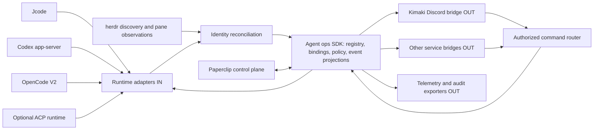

# Unified agent operations: design checkpoint

Date: 2026-11-11 (Pacific). Status: proposed architecture, not implemented or approved for production migration.

## Intent

Fork Kimaki, preserve its polished Discord interaction, support OpenCode plus Jcode and Codex, integrate Paperclip, and rationalize the existing bot and agent operations projects. Agent runtimes enter the SDK through runtime adapters (IN). Discord and other services are outward bridges (OUT), even though user commands travel back through them. Herdr must discover externally started agents and allow dynamic session binding without making Kimaki the lifecycle owner.

Fork: `KooshaPari/kimaki`. Local checkout: `E:\koosh\CodeProjects\kimaki`. Initial upstream commit: `fdbe1541d03d27c5174b3d1067f5e6f9cb9634f1`. Remote `upstream` preserves `remorses/kimaki`. No legacy repositories have been merged, deleted, moved, restarted, or rewritten.

## Non-negotiable boundaries

1. Discovery is not consent to publish transcripts, inject prompts, change permissions, or take control.
2. Binding is not process ownership. Detaching Discord never kills an external session.
3. Runtime transcript/turn truth stays with the runtime. The SDK owns identity reconciliation, bindings, permissions, command receipts and projections, not a second competing transcript authority.
4. Herdr owns pane/process observations. A pane, PID, cwd, and native session ID are different identities.
5. Paperclip owns its task, budget and organizational policy when a run originates there. It does not automatically acquire arbitrary external sessions.
6. Multiple observers are supported. Mutations require explicit control authority, and the SDK must not claim its lease fences a separate native TUI unless the backend actually enforces it.
7. Existing OpenCode behavior remains supported. Unsupported backend features are disabled visibly rather than emulated by altering another backend's session.
8. No blind monorepo merge. Preserve unique bot capabilities and state before retiring any implementation.

## Evidence from this checkout

The active package is `kimaki/`, not the older `cli/`. `kimaki/package.json` pins `@opencode/client` and `@opencode/plugin` at 2.0.29. `AGENTS.md`, the source and generated types take priority over historic sections of `docs/kimaki-v2-rebuild-spec.md`.

`kimaki/src/bot.ts` puts an OpenCode connection directly on the Discord bot context. `sessions.ts`, `prompt.ts`, `event-loop.ts`, and `thread-reducer.ts` are runtime-coupled. Adding a backend selector alone cannot provide compatibility.

External sessions are not entirely absent: `schema.ts:30-38` retains an `external_poll` source and `sessions.ts:750-776` supports resuming existing OpenCode sessions. However, `adoptSession` at lines 632-725 writes Kimaki metadata, changes permission rules, installs instructions, and removes previous bindings of the same session. That is adoption with mutation, not a passive attachment API. `event-loop.ts:11-13` explicitly drops unrelated TUI sessions that cannot be traced to an existing bound parent. Those are the exact seams the new requirement changes.

Kimaki already derives its run view from OpenCode events rather than treating Discord as transcript truth. Preserve that strength, but replace OpenCode-shaped global assumptions with runtime-scoped identities and capability declarations. Do not describe the current implementation as an ACP abstraction: the audited bot calls native OpenCode V2 APIs.

## Recommended architecture

**Recommended direction:** evolve the fork as the first integration host and Discord bridge, while keeping the SDK boundary independent of Discord. Federate existing projects first, then extract shared modules when real consumers justify it. Do not absorb Substrate's provider routing, herdr's terminal runtime, Paperclip's task scheduler, or every PhenoBot feature into a new universal scheduler.

The language default is TypeScript for this first SDK boundary because the fork is TypeScript. Rust services remain behind their existing protocols. Repository ownership and final package names are design calls, not user-approved facts.

### Authority map

| Domain | Authority | SDK stores |
| --- | --- | --- |
| Messages, turns, tool state | Native runtime | Cursor, normalized projection and provenance |
| Pane/process presence | herdr or host discovery | Observed identity, timestamps, confidence |
| Session identity | Native runtime identity plus host/endpoint scope | Stable internal key and aliases |
| Discord association | Binding registry | Surface ID, mode, visibility policy, generation |
| Command authorization | Explicit actor policy plus runtime policy | Durable command receipt and lease epoch |
| Paperclip task/budget | Paperclip | Correlation IDs and policy results |
| Usage | Runtime measurement | Reported units and source, unknown cost remains unknown |

### Proposed core records

- `RuntimeEndpoint`: backend kind, host identity, endpoint identity, capabilities, supported protocol version. No credentials in serialized registry rows.
- `SessionRef`: opaque stable internal ID mapped to `(hostId, endpointId, backendKind, nativeSessionId)`. Keep process incarnation separately so a daemon restart does not necessarily create a new logical session, and a reused PID never resurrects an old one.
- `DiscoveryObservation`: provider, observed native ID if available, pane ID, process incarnation, cwd, state, evidence time and confidence. Missing native ID means provisional presence, not an attachable transcript.
- `SurfaceBinding`: binding ID, session ID, service kind, tenant/surface/conversation IDs, observe/control mode, start cursor, history-publication policy and binding generation. Multiple observe bindings may exist.
- `ControlLease`: session ID, actor/controller, epoch, expiry and runtime enforcement level (`native` or `sdk-only`). Native UI contention must be disclosed and control denied when safe exclusivity cannot be established.
- `CommandReceipt`: stable command ID, source message/action ID, session and binding generation, lease epoch, state (`pending`, `accepted`, `confirmed`, `uncertain`, `rejected`). Ambiguous writes are reconciled, not blindly retried.
- `EventEnvelope`: schema version, event ID or source cursor, session ID, native turn/tool IDs when present, kind, observed time, source time if supplied, provenance, optional redacted payload.

These are proposed application records, not claims about existing upstream types. The implementation plan defines module ownership. Keep database changes additive and preserve old bindings read-only until migration verification passes.

### Dynamic discovery and binding

`unseen -> discovered -> resolved -> observed -> control-requested -> controlled` is the happy path. `ambiguous`, `unreachable`, `stale`, and `detached` are explicit states. A process that is visible but lacks a safe transcript API remains presence-only. Runtime reconnect can restore observation from a cursor. It never restores expired mutation authority automatically.

Default onboarding catches allowed agents in a private/local inventory. Combine native runtime session registries/subscriptions with herdr-managed pane observations and opt-in launch hooks for other entry points. Herdr discovery alone is not a promise to capture every process started on the host. Display discovery coverage and freshness per provider, and retain unresolved sightings instead of guessing a session from the newest file in a cwd. Auto-posting to a Discord channel requires an explicit per-project/host policy and tenant allowlist. The default history policy is new events after bind, not replay every historical message. Opt-in replay shows the scope before publication. Unrestricted discovery across all user processes or all repositories is out of scope.

Proposed user operations: discover/list, bind observe, request control, release control, move binding, detach, and separately stop an owned run. These are proposed commands, not currently implemented Kimaki slash commands. Moving a binding first installs a new generation and cursor, then retires the old delivery target without losing events. Cross-service echo suppression uses command/event causation IDs, not text comparisons.

### Backend strategy

- OpenCode: wrap the current native integration first, preserving its event/reducer behavior and existing plugin-specific features behind capabilities.
- Jcode: use a documented daemon/harness client boundary for persistent sessions after validating the installed version and Windows transport. `jcode run` is a one-shot execution path, not proof of live session attachment. The backend investigation found a concrete qualification blocker: bundled documentation describes `jcode api --stdio`, while installed help rejects the `api` subcommand. Do not assume that documented harness path is available on this Windows build.
- Codex: use app-server for rich persistent interactions. Verify thread listing/resume, live subscription and ownership against the installed protocol. A resumable historical thread is not proof a currently running CLI can be taken over.
- ACP: optional adapter when useful, not the universal identity registry. Negotiate load/list/resume and mode/config capabilities explicitly. `session/load` does not prove arbitrary process attach or concurrent safe control.
- herdr: discovery/control-plane integration only where its actual API supports it. Terminal text injection is not equivalent to native prompt submission and is not an automatic fallback.

### Paperclip strategy

Treat Paperclip as a distinct control plane, not another model provider or Discord renderer. It may submit bounded work through an adapter and consume correlated progress. External discovery is observation until an explicit Paperclip task association and authority decision occur. Prevent duplicate schedulers and competing budget/approval decisions. A heartbeat job and an interactive externally owned session have different lifecycle rules. At inspected Paperclip revision `f125b823f4c7c37680ffa788ceee1ab0bc8f44b1`, the native Runner is the preferred future harness integration direction and legacy adapters are a compatibility boundary. Qualify the deployed version before selecting one. In particular, `NativeSession.close()` stops provider work, so it cannot implement passive Discord detach. The inspected replay contract supports protocol versions 1 through 3, despite older README references to v1.

### Observability and security

Track discover-to-bind latency, bound session counts, evidence freshness, event gaps, reconnects, command outcomes, lease conflicts, pending approvals, service delivery latency, backlog, drops/coalescing, and reported token/cost usage. Separate operational metadata from opt-in transcript recording. Use source-scoped event deduplication, durable per-binding delivery cursors and an outbox for service writes. Coalesce replaceable text deltas under backpressure, but never silently discard tool approvals or terminal outcomes.

Do not ingest chain-of-thought/reasoning into public service output by default. Redact secrets and unsafe mentions, enforce attachment size/path policies, scope authorization by host/project/tenant, and require the same policy check for buttons, slash commands, text and programmatic requests. Bot credentials never enter runtime prompts. Keep native runtime sandbox and approval policies authoritative.

## Consolidation decision criteria

| Option | Benefit | Main cost/risk | Decision |
| --- | --- | --- | --- |
| Make Kimaki the umbrella and absorb every project | One checkout and familiar Discord UX | Imports unrelated schedulers/stores, paused governance and large upstream drift | Reject for first milestone |
| Merge Kimaki into PhenoBot | Reuses org bot, personas and forum/issue workflows | Inspected PhenoBot is frozen, and native session layer still needs abstraction | Defer pending owner approval and parity evidence |
| Build shared contracts and federate Kimaki, herdr, Paperclip and existing services | Preserves lifecycle owners and permits reversible adoption | Requires explicit identity/auth/delivery boundaries | Recommended |
| Replace everything with Paperclip's runtime plane | Centralizes Paperclip-originated work | External interactive sessions and Discord/PM features cannot be assumed equivalent | Use for Paperclip-owned runs only, not universal replacement |

The practical first host is this fork. Shared TypeScript contracts remain extractable, while Substrate and herdr keep their native implementation boundaries. The companion inventory documents source evidence and uninspected candidates, so final umbrella repository ownership remains open.

Before any retirement: enumerate commands, scheduled jobs, forum/GitHub mappings, personas, attachments, voice flows, credentials locations, pending tasks and user data. The inspected PhenoBot README imposes a strict freeze and owner sign-off, and AgentAPI++ declares itself folded into Substrate. Read-only audit is not permission to add dependents, extract code, unpause or resurrect either project. Locate the complete coordinated Substrate checkout before depending on its API. Replay representative workflows against the new boundary. Migrate one tenant/project in a reversible canary, retaining verified backups and binding cursors. Do not copy credentials or private production data into this public fork.

## Deliverables and approval boundary

Companion research documents under `docs/research/` contain backend, existing-project, Paperclip and herdr findings. The implementation plan is `docs/superpowers/plans/2026-11-11-unified-agent-ops.md`.

This checkpoint authorizes no product deployment or repository consolidation. Local documentation commits may contain local project topology, so do not push them to the public fork without a publication review. The next milestone after approval is an isolated contract/discovery vertical slice, not simultaneous migration of every bot.

## Storage preflight and coordination

At start, C: free bytes were 465,674,072,064, below the 500,000,000,000-byte policy threshold. E: is the verified Data volume, capacity 4,000,768,323,584 bytes with about 3.914 TB free. All new checkout and documentation output is on E:.

Migration inventory was initiated by enumerating legacy work roots, including `C:\Users\koosh\PhenoBot`, `AgCord`, `Dev`, `Projects`, and `CodeProjects`. Full relocation is not complete. Concurrent `Robocopy.exe` processes exist, including an active Fedora backup owned by another workflow. Other copy command lines were unavailable. Do not launch overlapping moves or stop writers. A safe continuation requires source/destination ownership coordination, full hidden/ignored/uncommitted inventory, capacity checks, verified copy, conflict handling, then source removal/junction and representative workflow checks. Live WSL disks are outside ordinary project relocation. This document records the blocker rather than claiming the storage policy has already been satisfied globally.
